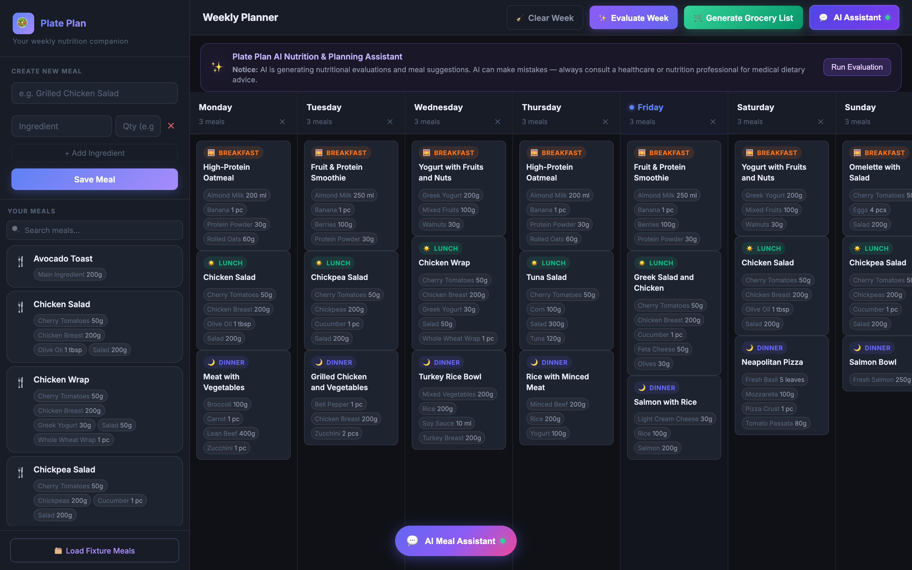
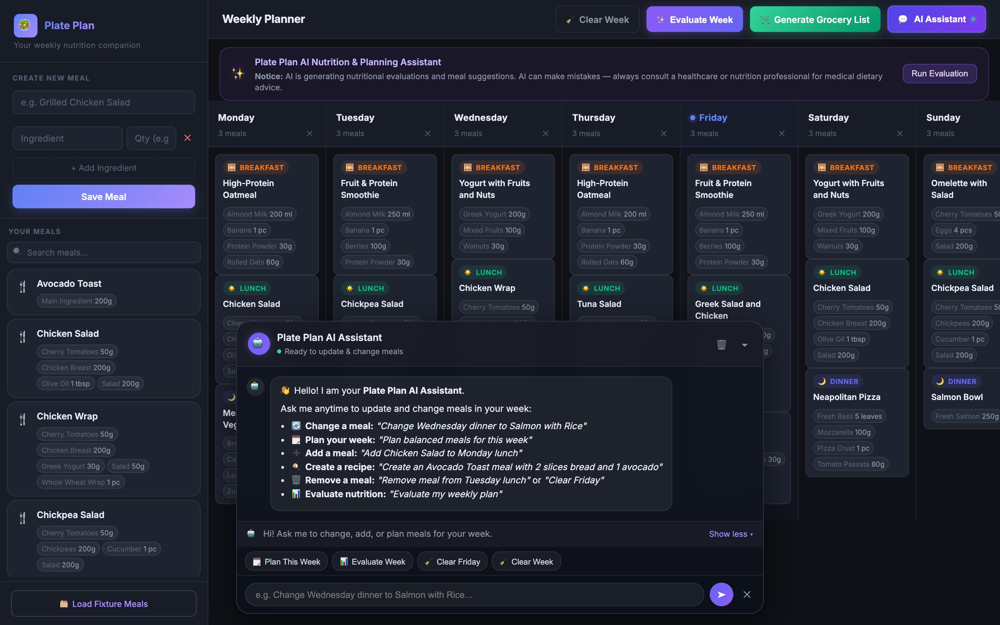
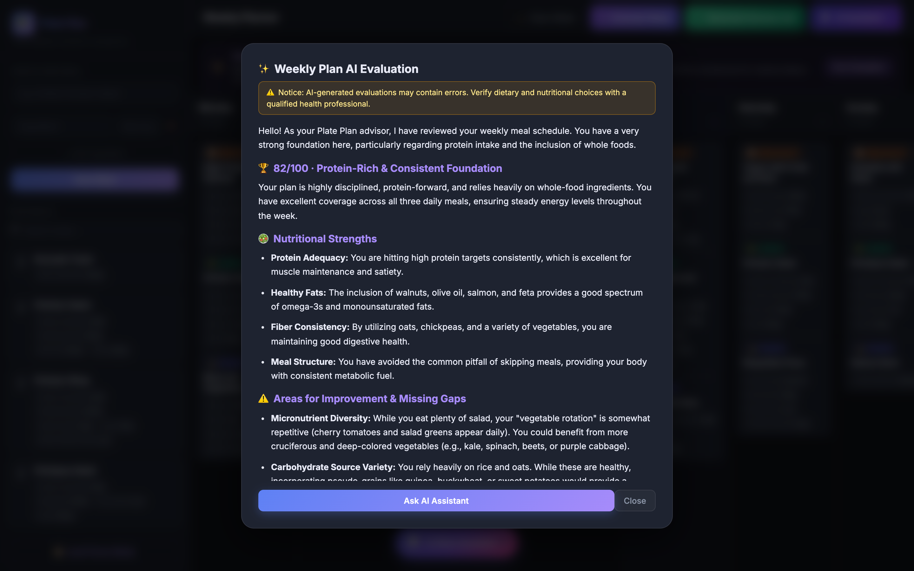
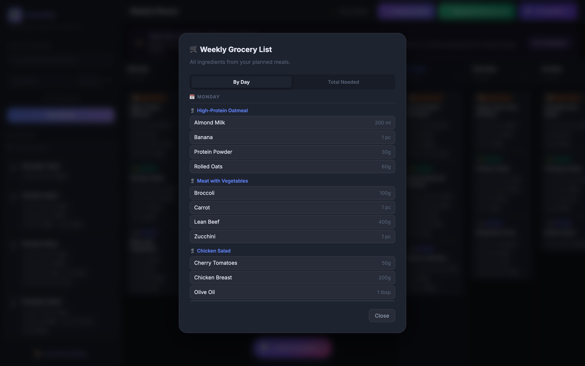
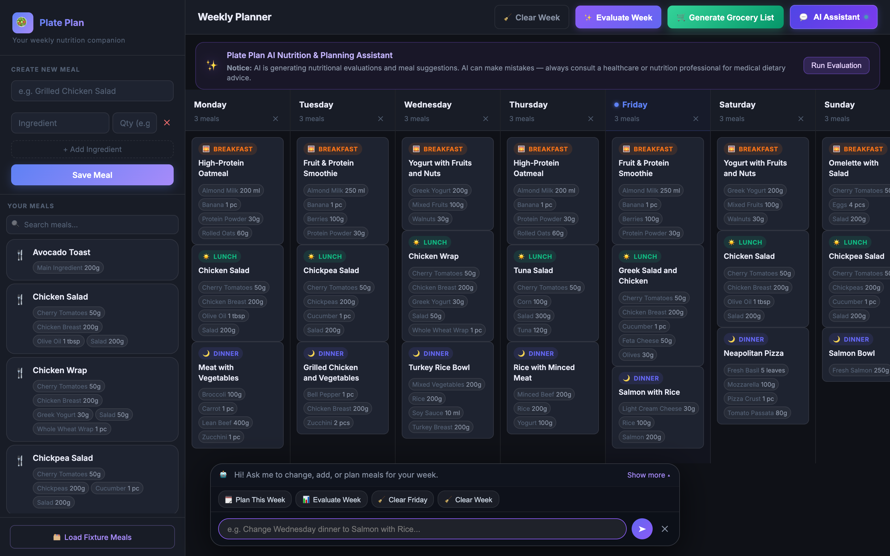

# 🥗 Plate Plan · Weekly Meal Planner & AI Assistant

[](LICENSE)
[](https://www.php.net/)
[](docker-compose.yml)
[](https://github.com/neuron-core/neuron-ai)
[](#-choosing-an-ai-provider)
[](https://github.com/future-site-ai/plate_plan)

A modern web application for organizing weekly meals, planning nutrition, managing ingredients with autocomplete and explicit units, generating consolidated grocery lists, and an AI assistant built on **[Neuron AI](https://github.com/neuron-core/neuron-ai)** that works with **Gemini, OpenAI, Anthropic Claude, Ollama (local models), Mistral, DeepSeek, Grok** or any OpenAI-compatible server, plus **MCP (Model Context Protocol)** tools.



## 🎬 Videos

<!-- After creating the playlist: replace PLAYLIST_ID with the ID of the Plate Plan playlist (https://www.youtube.com/playlist?list=PLAYLIST_ID).
     To show a different video here, replace qJLkjwNRvgg (twice) with that video's ID. -->
[](https://www.youtube.com/watch?v=qJLkjwNRvgg)

▶️ **[All Plate Plan videos on YouTube](https://www.youtube.com/playlist?list=PLDDixiPOk0k4)**: demos, guides and updates.

---

## ✨ Features

- 🗓️ **Weekly planner board**: breakfast, lunch, dinner and snacks for Monday to Sunday.
- 🖱️ **Drag & drop**: drag meals from your library onto any day, or drag planned meals **from one day to another** to move them.
- 🧹 **Clear a day or the whole week** in one click (with confirmation).
- 🍳 **Meal library**: create recipes with ingredient autocomplete and explicit units (`200g`, `1 pc`, `15 ml`).
- 🛒 **Smart grocery list**: by day, or consolidated totals that add up matching units.
- 🤖 **AI assistant chat**: plan a whole week, change, add or remove meals in plain language. The planner refreshes instantly.
- 📊 **AI nutrition evaluation**: a scored review with strengths, gaps, and actionable tips.
- 🔌 **MCP server & REST API**: connect Claude Desktop, Cursor, or any MCP client to your meal plan.
- 🔀 **Bring your own AI provider**: switch between Gemini, OpenAI, Claude, Ollama and more with one line in `.env.local`.
- 💡 **Works offline too**: without an AI provider configured, the app falls back to local heuristic planning and evaluation.

---

## 📸 Screenshots

| AI Assistant (docked at the bottom) | AI Weekly Evaluation |
|---|---|
|  |  |

| Weekly Grocery List | Compact Chat Bar |
|---|---|
|  |  |

---

## 📁 Project Architecture

The application is structured into clean, decoupled layers:

```text
plate_plan/
├── data/                       # Persistent SQLite database storage
│   ├── .gitkeep                # Tracks directory in git
│   └── diet.sqlite             # SQLite database (auto-bootstrapped & preserved)
├── src/                        # Core backend application logic & services
│   ├── AI/
│   │   ├── CallbackTool.php    # Neuron AI tool wrapper used by the assistant
│   │   └── ProviderFactory.php # Picks the AI provider (Gemini, OpenAI, Claude, Ollama, ...) from .env.local
│   ├── db.php                  # Database connection & schema bootstrapper
│   ├── fixture.php             # Seed recipes with standardized ingredient units
│   ├── MCP/
│   │   └── McpServer.php       # JSON-RPC 2.0 Model Context Protocol server
│   ├── request_guard.php       # Blocks cross-site requests and DNS rebinding (no login, so this matters)
│   └── Services/
│       ├── AiAgentService.php  # Neuron AI agent with tool calling & evaluation
│       ├── PlatePlanService.php# Domain business logic (meals, plan, groceries)
│       └── PromptService.php   # Central repository for all system & evaluation prompts
├── public/                     # Web server DocumentRoot
│   ├── css/
│   │   └── style.css           # Premium Dark-Glass UI with AI & Chatbot styling
│   ├── js/
│   │   └── script.js           # Drag-and-drop board, AI chat bar, evaluation
│   ├── .htaccess               # URL rewrite rules & Apache routing
│   ├── api.php                 # Direct REST & JSON API endpoints
│   ├── index.php               # Web entry point & UI router
│   └── mcp.php                 # Model Context Protocol (MCP) HTTP endpoint
├── docs/
│   └── screenshots/            # Images used in this README
├── .dockerignore               # Files excluded from Docker context
├── .env.example                # Template for environment settings
├── .env.local                  # Local secrets (AI provider & API key) - git ignored
├── .gitignore                  # Comprehensive Git ignore rules
├── composer.json               # Dependencies (neuron-core/neuron-ai, vlucas/phpdotenv)
├── docker-compose.yml          # Docker Compose service definition (maps port 1111)
├── Dockerfile                  # PHP 8.2 Apache + SQLite3 + Composer container
├── docker-entrypoint.sh        # Container startup script (handles SQLite permissions)
├── LICENSE                     # MIT License
└── README.md                   # Full documentation
```

---

## 🚀 Quick Start with Docker

### 1. Configure Secrets in `.env.local`
Copy the example file and add the API key for your AI provider (Gemini by default):

```bash
cp .env.example .env.local
```

```bash
# In .env.local
AI_PROVIDER=gemini
AI_API_KEY=AIzaSy...
```

Want to use OpenAI, Claude, or a local Ollama model instead? See **[Choosing an AI Provider](#-choosing-an-ai-provider)**.

*(If you don't have an API key yet, the app also provides local heuristic planning and evaluations out of the box!)*

### 2. Start the Application
```bash
docker compose up -d
```

### 3. Open in Browser
Visit **[http://localhost:1111](http://localhost:1111)**.

---

## 🔀 Choosing an AI Provider

The assistant and the weekly evaluation run on **[Neuron AI](https://github.com/neuron-core/neuron-ai)**, so you can switch the LLM behind them without touching any code. Set these variables in `.env.local`:

| Variable | Description |
|---|---|
| `AI_PROVIDER` | `gemini` (default), `openai`, `anthropic`, `ollama`, `mistral`, `deepseek`, `grok`, or `openai_like` |
| `AI_MODEL` | Model name. Optional when the provider has a default (see below) |
| `AI_API_KEY` | API key for the provider. You can use the provider-specific variable instead (e.g. `OPENAI_API_KEY`) |
| `AI_BASE_URL` | Endpoint for `ollama` or `openai_like` |

| Provider | `AI_PROVIDER` | Default model | Key variable (alternative to `AI_API_KEY`) |
|---|---|---|---|
| Google Gemini | `gemini` | `gemini-2.5-flash` | `GEMINI_API_KEY` |
| OpenAI | `openai` | `gpt-4o-mini` | `OPENAI_API_KEY` |
| Anthropic Claude | `anthropic` | `claude-sonnet-5-5` | `ANTHROPIC_API_KEY` |
| Ollama (local) | `ollama` | `llama3.1` | *(no key needed)* |
| Mistral | `mistral` | `mistral-large-latest` | `MISTRAL_API_KEY` |
| DeepSeek | `deepseek` | `deepseek-chat` | `DEEPSEEK_API_KEY` |
| xAI Grok | `grok` | *(set `AI_MODEL`)* | `XAI_API_KEY` |
| Any OpenAI-compatible API (OpenRouter, Groq, LM Studio, vLLM, ...) | `openai_like` | *(set `AI_MODEL`)* | `AI_API_KEY` |

### Examples

**OpenAI**
```bash
AI_PROVIDER=openai
AI_MODEL=gpt-4o-mini
AI_API_KEY=sk-...
```

**Anthropic Claude**
```bash
AI_PROVIDER=anthropic
AI_MODEL=claude-sonnet-5-5
AI_API_KEY=sk-ant-...
```

**Ollama (free, runs on your machine)**
```bash
# 1. Install Ollama from https://ollama.com and pull a model that supports tool calling
ollama pull llama3.1

# 2. In .env.local
AI_PROVIDER=ollama
AI_MODEL=llama3.1
# The app runs inside Docker, so point it at your host machine:
AI_BASE_URL=http://host.docker.internal:11434/api
```
> On Linux, also add `extra_hosts: ["host.docker.internal:host-gateway"]` to the `app` service in `docker-compose.yml`. When running PHP directly on your machine (without Docker), use `http://localhost:11434/api`.

**Any OpenAI-compatible server (example: OpenRouter)**
```bash
AI_PROVIDER=openai_like
AI_BASE_URL=https://openrouter.ai/api/v1
AI_MODEL=meta-llama/llama-3.3-70b-instruct
AI_API_KEY=sk-or-...
```

### Applying the change
Docker reads `.env.local` when the container is created, so recreate it after editing:

```bash
docker compose up -d --force-recreate
```

### Tips
- The assistant **plans and edits your week through tool calling**, so pick a model that supports tools/function calling (most current models do; for Ollama use e.g. `llama3.1`, `qwen2.5`, or `mistral-nemo`).
- Existing setups keep working: with `AI_PROVIDER` unset, the app uses Gemini with `GEMINI_API_KEY` and `GEMINI_MODEL`.
- If the provider is not configured (missing key or model), the app automatically switches to its offline heuristic mode.
- To add another provider supported by Neuron AI (e.g. AWS Bedrock, Cohere, Hugging Face), add a line to [`src/AI/ProviderFactory.php`](src/AI/ProviderFactory.php).

---

## 🗄️ Database

Plate Plan stores everything in a single **SQLite** file, so there is no database server to install.

- **Location:** `data/diet.sqlite` by default. Change it with `DB_PATH` in `.env.local` (inside Docker the default is `/var/www/html/data/diet.sqlite`).
- **Automatic setup:** the tables are created on the first request ([`src/db.php`](src/db.php)), so a fresh clone works immediately.
- **Persistence:** `docker-compose.yml` mounts the project folder into the container, so your data survives restarts and rebuilds.
- **Sample data:** click **🗂️ Load Fixture Meals** in the sidebar to import the recipes from [`src/fixture.php`](src/fixture.php). Running it again updates those recipes instead of duplicating them.
- **Git:** `*.sqlite` files are git-ignored, so your personal meal data is never committed.

### Schema

| Table | Columns | Notes |
|---|---|---|
| `meals` | `id`, `name` | Meal names are case-insensitive |
| `ingredients` | `id`, `meal_id`, `name`, `quantity` | Deleted automatically with their meal |
| `weekly_plan` | `id`, `day_of_week` (1–7, Monday = 1), `meal_id`, `meal_type` | `meal_type` is `breakfast`, `lunch`, `dinner` or `snack` |

### Common tasks

**Back up your data**
```bash
cp data/diet.sqlite data/diet-backup-$(date +%Y%m%d).sqlite
```

**Restore a backup**
```bash
docker compose stop
cp data/diet-backup-YYYYMMDD.sqlite data/diet.sqlite
rm -f data/diet.sqlite-wal data/diet.sqlite-shm
docker compose start
```

**Reset to an empty database** *(this deletes all meals and plans)*
```bash
docker compose stop
rm -f data/diet.sqlite data/diet.sqlite-wal data/diet.sqlite-shm
docker compose start
```

**Inspect the data with the SQLite CLI**
```bash
sqlite3 data/diet.sqlite "SELECT * FROM meals;"
```
> The database runs in WAL mode, so you may see `diet.sqlite-wal` and `diet.sqlite-shm` next to it. They are normal; keep them together with the main file while the app is running.

---

## 🤖 AI Assistant & Evaluation Features

### 1. AI Chat Assistant
Click **💬 AI Assistant** in the top bar, or the **AI Meal Assistant** button at the bottom-center of the screen. The chat opens as a compact bar docked at the bottom, so **the dashboard stays visible** while the AI works:
- A one-line status above the input shows what the AI is doing (*"Thinking and planning..."*) and then a preview of its reply. Click **Show more** to expand the full conversation.
- Quick-action chips: **Plan This Week**, **Evaluate Week**, **Clear Friday**, **Clear Week**.

Things you can ask:
- **Plan your week:** *"Plan meals for this week"*. The AI saves breakfast, lunch and dinner for all 7 days straight into the planner.
- **Change a meal:** *"Change Wednesday dinner to Salmon with Rice"*
- **Add meals to days:** *"Add Chicken Salad to Monday lunch"*
- **Create new recipes:** *"Create Avocado Toast with 2 slices bread and 1 avocado"*
- **Clear days or the whole week:** *"Clear Wednesday"*, *"Clear the whole week"*
- **Evaluate nutrition:** *"Evaluate my weekly meal plan"*
- When the AI performs any scheduling changes, the planner board and meal library **instantly refresh** in real time!

### 2. AI Weekly Plan Evaluation
- Click the **✨ Evaluate Week** button in the top bar or inside the dashboard notice banner.
- The AI performs a deep analysis of your scheduled meals:
  - 🏆 **Overall Score & Summary**
  - 🥗 **Nutritional Strengths & Macro Distribution**
  - ⚠️ **Areas for Improvement & Gaps**
  - 💡 **Actionable Tips for the Week**
- **Dashboard Notice:** A prominent notice is displayed:
  > *⚠️ Notice: AI is generating this evaluation. AI can make mistakes — always consult a healthcare or nutrition professional for medical dietary advice.*

---

## 🔌 Model Context Protocol (MCP) Server

Plate Plan implements an official **MCP (Model Context Protocol)** endpoint compliant with the JSON-RPC 2.0 specification.

- **MCP Endpoint URL:** `http://localhost:1111/mcp.php` (or `http://localhost:1111/mcp`)
- **Transport:** HTTP / JSON-RPC 2.0

### Available MCP Tools:
1. `get_meals`: List all recipes in library with ingredients and units.
2. `create_meal`: Create a new meal with ingredients (`name`, `quantity` with unit).
3. `delete_meal`: Delete a meal by `meal_id`.
4. `get_weekly_plan`: Retrieve current Monday–Sunday schedule across breakfast, lunch, dinner, snack.
5. `add_to_plan`: Schedule meal (`day_of_week`: 1–7, `meal_id`, `meal_type`).
6. `remove_from_plan`: Remove item from schedule by `plan_id`.
7. `clear_day`: Clear all meals for a day (`day_of_week`: 1–7).
8. `get_grocery_list`: Generate consolidated grocery shopping list.
9. `evaluate_weekly_plan`: Run AI nutritional and variety evaluation.

### Connecting External AI Agents to Plate Plan MCP:
You can configure any MCP client (such as Claude Desktop, Cursor, or Antigravity) with:

```json
{
  "mcpServers": {
    "plate-plan": {
      "url": "http://localhost:1111/mcp.php"
    }
  }
}
```

### 🔒 Request protection

Plate Plan has no login, so it blocks requests that come from **other websites** open in your browser (cross-site requests and DNS rebinding). Desktop MCP clients, `curl` and scripts are not affected. Two settings in `.env.local` relax this when you need to:

| Setting | When to use it |
|---|---|
| `PLATE_PLAN_ALLOWED_HOSTS` | You open Plate Plan from another device or name, e.g. `192.168.1.20` or `plate-plan.local` (comma-separated). |
| `PLATE_PLAN_ALLOWED_ORIGINS` | A browser-based tool must call the API or MCP server, e.g. the MCP Inspector: `http://localhost:6274`. |

Plate Plan is meant for your own computer or home network. **Do not expose it to the internet** without a VPN or a reverse proxy with authentication. See [SECURITY.md](SECURITY.md).

---

## 📡 REST & JSON API Endpoints

A dedicated endpoint [`public/api.php`](public/api.php) is available for programmatic integration:

| Method | Endpoint | Action | Description |
|---|---|---|---|
| `GET / POST` | `/api.php?action=meals` | `get_meals` | Get all meals with ingredients |
| `GET / POST` | `/api.php?action=weekly_plan` | `get_weekly_plan` | Get weekly schedule |
| `POST` | `/api.php` | `add_to_plan` | Add meal to day & slot |
| `POST` | `/api.php` | `create_meal` | Create a new meal |
| `POST` | `/api.php` | `remove_from_plan` | Remove scheduled meal |
| `GET / POST` | `/api.php?action=grocery_list` | `get_grocery_list` | Get aggregated grocery list |
| `POST` | `/api.php` | `evaluate_weekly_plan`| Run AI evaluation |
| `POST` | `/api.php` | `chat` | Chat with AI agent |

The web UI (`index.php`) additionally exposes `move_in_plan` (move a planned meal to another day) and `clear_week` (remove every meal from the week).

---

## 🧠 Centralized Prompt Service

All system prompts, user prompts, evaluation criteria, and disclaimers are centralized in:

📂 [`src/Services/PromptService.php`](src/Services/PromptService.php)

- `PromptService::getAssistantSystemPrompt()`
- `PromptService::getEvaluationSystemPrompt()`
- `PromptService::formatEvaluationPrompt($weeklyPlan, $allMeals)`
- `PromptService::getNoticeDisclaimer()`

---

## 📦 Managing Dependencies with Composer

```bash
docker compose exec app composer require <vendor/package-name>
```

Pre-installed libraries:
- `neuron-core/neuron-ai`: Agentic AI framework powering the assistant, with providers for Gemini, OpenAI, Anthropic, Ollama, Mistral, DeepSeek, Grok and more.
- `vlucas/phpdotenv`: Environment management for `.env.local`.

---

## 📏 Ingredient Units & Grocery Consolidation

Ingredient quantities in [`src/fixture.php`](src/fixture.php) and the UI are standardized with explicit units (e.g. `200g`, `1 pc`, `10 ml`, `4 pcs`, `1 tbsp`).
The grocery list automatically consolidates numeric amounts that share the same unit!

---

## 🤝 Contributing

Contributions are welcome! Bug reports, ideas, docs and code all help. Read **[CONTRIBUTING.md](CONTRIBUTING.md)** to get started, and look for issues labelled [`good first issue`](https://github.com/future-site-ai/plate_plan/labels/good%20first%20issue).

## 📄 License

Plate Plan is open source under the [MIT License](LICENSE). You are free to use, modify, and distribute it, including commercially, as long as the copyright and license notice are kept.

## 🙌 Using This Project?

If you use Plate Plan or build on its source code, please **credit the project by linking back to this repository**:

```markdown
Based on [Plate Plan](https://github.com/future-site-ai/plate_plan) by Future Site Di Haidar Anbar.
```

---

## ⭐ Support the Project

If you find Plate Plan useful, please kindly:

- ⭐ **[Star this repository](https://github.com/future-site-ai/plate_plan)**. It helps others discover the project.
- 👤 **[Follow me on GitHub](https://github.com/future-site-ai)** for more open-source projects.
- 🔗 **Link back to [this repo](https://github.com/future-site-ai/plate_plan)** whenever you use or share this source code.

Thank you for your support! 💚
